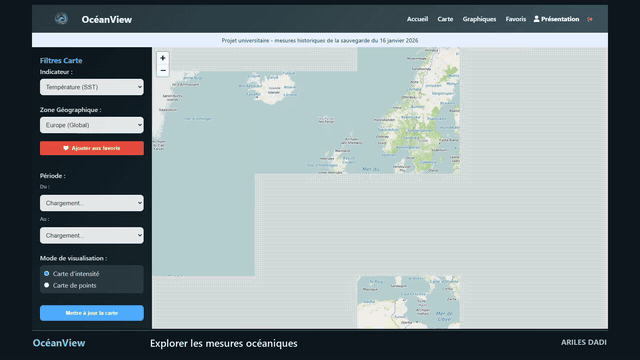

# OcéanView - Exploration de données marines

Projet universitaire réalisé à cinq en BUT Informatique à l’IUT de Créteil-Vitry (UPEC). Nous avons partagé les tâches entre le traitement des données et le développement de l’application.

OcéanView permet de :
- Filtrer des mesures de température de surface, de salinité et de chlorophylle-a sur une carte.
- Comparer les mesures dans des graphiques.
- Créer un compte local et enregistrer des sélections en favoris.

**Outils :** Python, Flask, MySQL, Leaflet et Plotly.

## Aperçu du projet

La vidéo montre les mesures [Copernicus Marine](https://marine.copernicus.eu/) de 2024-2025 utilisées dans le projet d’origine. Ce dépôt fournit **576 mesures fictives**, sur 16 positions et 12 dates, pour tester l’application.

[Image en grand format](docs/apercu.png) · [Voir la vidéo](docs/presentation.mp4)

## Télécharger et lancer

1. Installe [Python 3.14](https://www.python.org/downloads/) si besoin, en cochant **Add python.exe to PATH**.
2. [Télécharge le projet en ZIP](https://github.com/ArilesD/oceanview-copernicus/archive/refs/heads/main.zip), fais **Extraire tout**, puis ouvre le dossier extrait.
3. Double-clique sur **LANCER.cmd**.

Le premier lancement nécessite Internet pour installer les bibliothèques. Garde la fenêtre de lancement ouverte pendant l’utilisation et appuie sur **Entrée** dans cette fenêtre pour arrêter le projet.

Le lancement prépare MySQL et les données de test, puis ouvre le site. Crée un compte via **Inscription** avec un mot de passe d’au moins huit caractères, puis connecte-toi.

La première préparation peut télécharger MySQL (environ 268 Mo). Prévois environ **1 Go d’espace libre**. La carte et les graphiques nécessitent Internet.

Si le lancement signale une bibliothèque manquante pour MySQL, installe le [Microsoft Visual C++ Redistributable x64](https://aka.ms/vs/17/release/vc_redist.x64.exe), puis relance le projet.

## Comprendre les fichiers

| Fichier ou dossier | Rôle |
| --- | --- |
| `LANCER.cmd` et `lancer.py` | Préparent et démarrent le projet. |
| `mysql_local.py` | Prépare la base MySQL locale. |
| `app/controllers/` | Pages et données demandées par la carte et les graphiques. |
| `app/models/` | Requêtes et accès à MySQL. |
| `app/templates/` et `app/static/` | Interface, carte et graphiques. |
| `app/schema_demo.sql` et `app/demo.py` | Structure de la base et génération des mesures fictives. |

Les crédits de l’équipe figurent dans la page **À propos**. [Carte avec les mesures fictives](docs/carte-demo.jpg) · [Graphique des mesures fictives](docs/graphique-demo.jpg)

Fond de carte © OpenStreetMap France et [contributeurs OpenStreetMap](https://www.openstreetmap.org/copyright).
