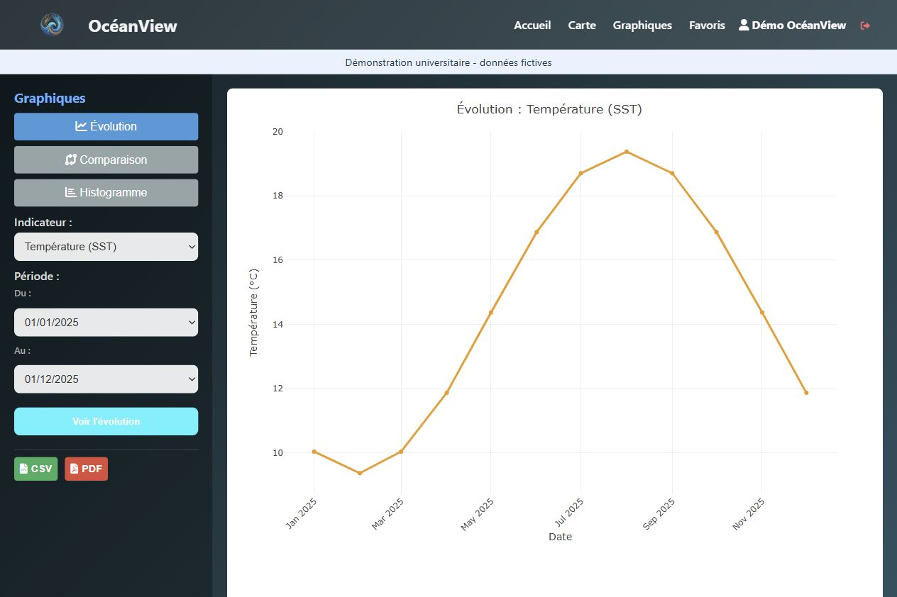

# OcéanView - Explorer les données marines de Copernicus

OcéanView est une application web d’exploration de données de surface. Elle associe une carte Leaflet à des graphiques Plotly pour suivre la température de surface (SST), la salinité de surface (SSS) et la chlorophylle-a.

- **Projet universitaire** - L’équipe a utilisé des données de surface issues de [Copernicus Marine](https://marine.copernicus.eu/) sur la période 2024-2025.
- **Démo de ce dépôt** - La commande d’initialisation génère 576 mesures fictives sur 16 positions et 12 dates. Elles servent à tester l’application et les requêtes.



## Ce que montre la démonstration

- Choisir une zone, un indicateur et une période sur la carte. Afficher les mesures par points ou par intensité.
- Suivre l’évolution d’un indicateur, comparer deux indicateurs ou visualiser leur distribution.
- Créer un compte local et enregistrer une sélection en favori. La carte et les graphiques proposent aussi des exports CSV et PDF.

[Aperçu de la carte avec les points fictifs](docs/carte-demo.jpg) · Fond de carte © OpenStreetMap France et [contributeurs OpenStreetMap](https://www.openstreetmap.org/copyright).

## Lancer en local

Installe Python 3.12 et MySQL 8.4. La carte et les graphiques chargent leurs bibliothèques et leurs fonds depuis Internet.

Crée une base MySQL dédiée avec ton compte d’administration. Dans les commandes ci-dessous, remplace `mot-de-passe-local-a-choisir` par le mot de passe du nouveau compte MySQL local.

```sql
CREATE DATABASE oceanview_demo CHARACTER SET utf8mb4;
CREATE USER 'oceanview'@'127.0.0.1' IDENTIFIED BY 'mot-de-passe-local-a-choisir';
GRANT ALL PRIVILEGES ON oceanview_demo.* TO 'oceanview'@'127.0.0.1';
```

Depuis la racine du dépôt, crée un environnement virtuel et le fichier de configuration local.

**Windows PowerShell**

```powershell
python -m venv .venv
.\.venv\Scripts\Activate.ps1
New-Item -ItemType Directory -Force instance
Copy-Item config.example.py instance/config.py
```

**macOS ou Linux**

```bash
python -m venv .venv
source .venv/bin/activate
mkdir -p instance
cp config.example.py instance/config.py
```

Renseigne ton mot de passe MySQL dans `instance/config.py`, puis installe les dépendances et initialise les données.

```bash
python -m pip install -r requirements.txt
python -m flask --app run init-demo
python run.py
```

Ouvre [OcéanView sur ton ordinateur](http://127.0.0.1:5001) et crée un compte via **Inscription**. Pour tester l’administration, lance `python -m flask --app run init-demo --admin-email admin@example.test`. La commande te demande de choisir le mot de passe de ce compte.

## Lire le code

| Chemin | Rôle |
| --- | --- |
| `app/controllers/` | Routes Flask et API utilisée par la carte et les graphiques. |
| `app/models/` | Connexion MySQL, requêtes et accès aux comptes. |
| `app/templates/` et `app/static/` | Pages, carte et graphiques. |
| `app/schema_demo.sql` et `app/demo.py` | Schéma MySQL et génération des données fictives. |

## Travail en équipe

Projet universitaire réalisé à cinq en BUT Informatique à l’IUT de Créteil-Vitry (UPEC). Nous avons partagé les tâches entre le travail sur les données et le développement de l’application. Les crédits de l’équipe figurent aussi dans la page **À propos**.
