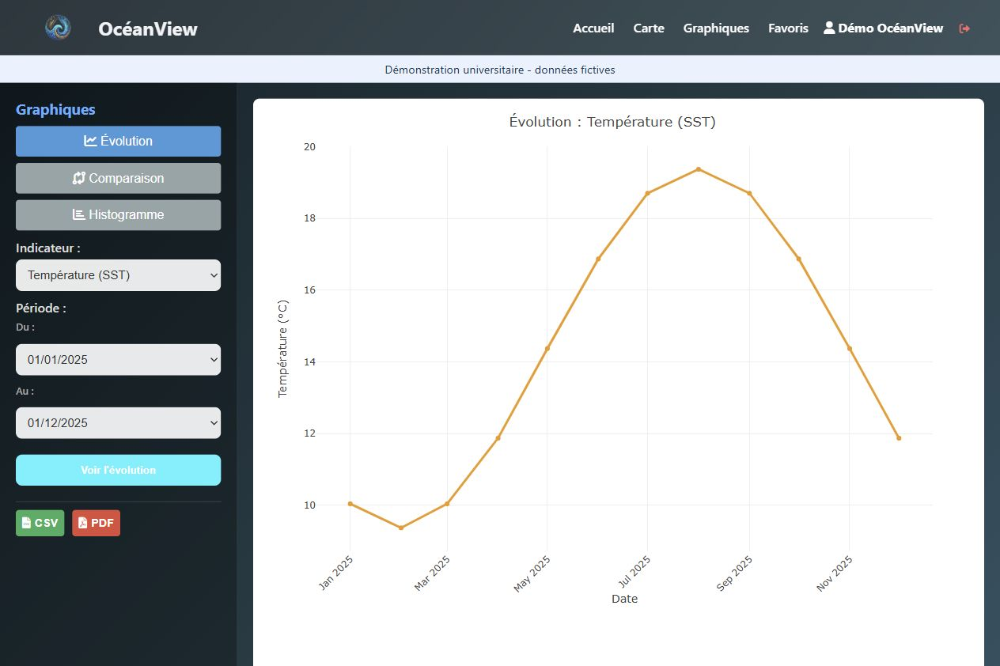

# OcéanView - Explorer les données marines de Copernicus

OcéanView est une application web d’exploration de données de surface. Elle associe une carte Leaflet à des graphiques Plotly pour suivre la température de surface (SST), la salinité de surface (SSS) et la chlorophylle-a.

- **Projet universitaire** - L’équipe a utilisé des données de surface issues de [Copernicus Marine](https://marine.copernicus.eu/) sur la période 2024-2025.
- **Démo de ce dépôt** - La commande d’initialisation génère 576 mesures fictives sur 16 positions et 12 dates. Elles servent à tester l’application et les requêtes.

## Aperçu du projet


Enregistrement de la version universitaire avec ses mesures historiques Copernicus. Le téléchargement de ce dépôt prépare 576 mesures fictives pour tester les mêmes fonctions.

[Voir la vidéo en grand format](docs/presentation.mp4) · [Mon parcours et mes autres projets](https://github.com/ArilesD)

## Télécharger et lancer

1. [Télécharge le ZIP complet](https://github.com/ArilesD/oceanview-copernicus/archive/refs/heads/main.zip).
2. Dans l’Explorateur Windows, fais **Extraire tout**, puis ouvre le dossier extrait.
3. Installe [Python 3.14](https://www.python.org/downloads/) si besoin, en cochant **Add python.exe to PATH**. Double-clique ensuite sur **LANCER.cmd**.

Le lancement prépare MySQL dans le dossier du projet, génère les 576 mesures fictives décrites ci-dessous et ouvre le site. Crée un compte dans **Inscription** avec huit caractères minimum pour le mot de passe, puis connecte-toi pour ouvrir la carte et les graphiques.

Garde la fenêtre de lancement ouverte pendant l’utilisation. Appuie sur **Entrée** dans cette fenêtre pour arrêter le projet. La première préparation des applications Python installe les bibliothèques depuis Internet. Les ouvertures suivantes réutilisent l’installation du dossier.

### Première préparation de MySQL

Sous Windows 64 bits, le lanceur utilise MySQL 8.4 si son dossier est indiqué dans **MYSQL_HOME** ou s’il est installé dans son emplacement habituel. Sinon, il télécharge automatiquement l’archive officielle de MySQL 8.4.13 (environ 268 Mio), la vérifie et l’extrait dans **.local/outils/**. Prévois environ 1 Go d’espace libre. Une base dédiée et des identifiants locaux sont créés dans **.local/mysql/**.

Si MySQL signale une bibliothèque Windows manquante, installe le [Microsoft Visual C++ Redistributable x64](https://aka.ms/vs/17/release/vc_redist.x64.exe), puis relance le projet. [Téléchargements officiels MySQL](https://dev.mysql.com/downloads/mysql/8.4.html) · [Installation MySQL sur Windows](https://dev.mysql.com/doc/refman/8.4/en/windows-install-archive.html)

Sous macOS ou Linux, suis la section **Lancer en local** pour préparer ta propre base MySQL.




## Ce que montre la démonstration

- Choisir une zone, un indicateur et une période sur la carte. Afficher les mesures par points ou par intensité.
- Suivre l’évolution d’un indicateur, comparer deux indicateurs ou visualiser leur distribution.
- Créer un compte local et enregistrer une sélection en favori. La carte et les graphiques proposent aussi des exports CSV et PDF.

[Aperçu de la carte avec les points fictifs](docs/carte-demo.jpg) · Fond de carte © OpenStreetMap France et [contributeurs OpenStreetMap](https://www.openstreetmap.org/copyright).

## Lancer en local

Prépare Python 3.12 ou 3.14 et démarre MySQL 8.4. La carte et les graphiques chargent leurs bibliothèques et le fond de carte depuis Internet.

Crée une base MySQL dédiée avec ton compte d’administration. Dans les commandes ci-dessous, remplace `mot-de-passe-local-a-choisir` par le mot de passe du nouveau compte MySQL local.

```sql
CREATE DATABASE oceanview_demo CHARACTER SET utf8mb4;
CREATE USER 'oceanview'@'127.0.0.1' IDENTIFIED BY 'mot-de-passe-local-a-choisir';
GRANT ALL PRIVILEGES ON oceanview_demo.* TO 'oceanview'@'127.0.0.1';
```

Depuis la racine du dépôt, crée un environnement virtuel et le fichier de configuration local.

**Windows PowerShell**

```powershell
python -m venv .venv
New-Item -ItemType Directory -Force instance
Copy-Item config.example.py instance/config.py
```

**macOS ou Linux**

```bash
python -m venv .venv
source .venv/bin/activate
mkdir -p instance
cp config.example.py instance/config.py
```

Renseigne ton mot de passe MySQL dans `instance/config.py`, puis installe les dépendances, initialise les données et démarre l’application.

**Windows PowerShell**

```powershell
.\.venv\Scripts\python.exe -m pip install -r requirements.txt
.\.venv\Scripts\python.exe -m flask --app run init-demo
.\.venv\Scripts\python.exe run.py
```

**macOS ou Linux**

```bash
python -m pip install -r requirements.txt
python -m flask --app run init-demo
python run.py
```

Ouvre [OcéanView sur ton ordinateur](http://127.0.0.1:5001) et crée un compte via **Inscription**. Connecte-toi pour accéder à la carte et aux graphiques.

### Reproduire les aperçus

- Dans **Carte**, choisis **Température (SST)**, **Europe (Global)** et **Carte de points**. Garde la période du 1er janvier au 1er décembre 2025 et clique sur **Mettre à jour la carte**. Les 192 mesures de température sont regroupées sur la carte selon le zoom.
- Dans **Graphiques**, choisis **Évolution** et **Température (SST)** sur la même période. Clique sur **Voir l’évolution** pour afficher les 12 valeurs de la démo.

Pour tester l’administration, ajoute `--admin-email admin@example.test` à la commande `init-demo`. L’application te demande de choisir le mot de passe de ce compte.

## Lire le code

| Chemin | Rôle |
| --- | --- |
| `app/controllers/` | Routes Flask et API utilisée par la carte et les graphiques. |
| `app/models/` | Connexion MySQL, requêtes et accès aux comptes. |
| `app/templates/` et `app/static/` | Pages, carte et graphiques. |
| `app/schema_demo.sql` et `app/demo.py` | Schéma MySQL et génération des données fictives. |

## Travail en équipe

Projet universitaire réalisé à cinq en BUT Informatique à l’IUT de Créteil-Vitry (UPEC). Nous avons partagé les tâches entre le travail sur les données et le développement de l’application. Les crédits de l’équipe figurent aussi dans la page **À propos**.
